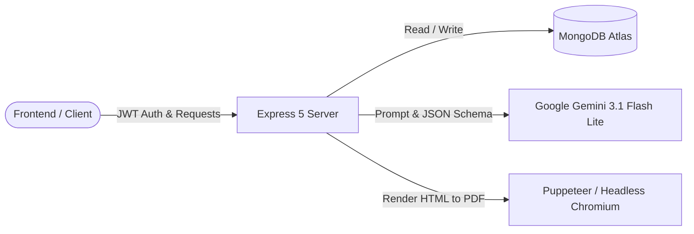

# AI Resume Analyzer — Backend Service

[](https://nodejs.org/)
[](https://expressjs.com/)
[](https://www.mongodb.com/)
[](https://ai.google.dev/)
[](https://pptr.dev/)

The backend REST API server powering the AI Resume Analyzer application. It handles user authentication, multipart file uploads, in-memory PDF extraction, Google Gemini structured output orchestration, MongoDB persistence, and headless Chromium single-page PDF synthesis.

---

## Architecture & Responsibilities



### Core Responsibilities
- **Authentication**: JWT token issuance in cookies, salted password hashing with `bcrypt`, and token blacklist validation with MongoDB TTL indexes.
- **PDF Extraction**: In-memory parsing using `multer.memoryStorage()` (3MB threshold) and `pdf-parse`.
- **AI Structured Generation**: Gemini 3.1 Flash Lite inference constrained by strict JSON schemas (`responseSchema`) for predictable match scoring, skill gap extraction, and project recommendations.
- **PDF Synthesis**: On-demand single-page A4 PDF rendering with Puppeteer using optimized Chromium flags.
- **Connection Awareness**: Aborts heavy LLM and Puppeteer operations upon client connection drop (`req.on('close')`).

---

## Directory Structure

```text
Backend/
├── src/
│   ├── config/
│   │   ├── mongoose-connection.js   # MongoDB connection logic
│   │   └── multer-config.js         # Multer in-memory storage config
│   ├── controllers/
│   │   ├── getMeController.js       # User profile controller
│   │   ├── loginController.js       # Login controller
│   │   ├── logoutController.js      # Logout controller & blacklist entry
│   │   ├── registerController.js    # Registration controller
│   │   └── resumeReportController.js# Resume analysis controller
│   ├── middlewares/
│   │   └── isLoggedIn.js            # JWT auth & blacklist verification
│   ├── models/
│   │   ├── resume-model.js          # Resume report schema
│   │   ├── token-blacklist-model.js # Blacklist schema with 3-day TTL
│   │   └── user-model.js            # User profile schema
│   ├── routes/
│   │   ├── authRoutes.js            # /api/auth endpoints
│   │   └── resumeRoutes.js          # /api/resume endpoints
│   ├── services/
│   │   └── ai.js                    # Gemini GenAI & Puppeteer engine
│   └── app.js                       # Express app configuration & middleware
├── Dockerfile                       # Production container with system Chromium
├── package.json                     # Node.js dependencies & scripts
└── server.js                        # HTTP server bootstrap
```

---

## Getting Started

### Prerequisites
- Node.js `20.x` or higher
- Running MongoDB instance (local or MongoDB Atlas)
- Google Gemini API key

### 1. Installation
```bash
npm install
```

### 2. Environment Configuration
Create a `.env` file in the `Backend/` directory:
```env
PORT=3000
MONGODB_URI=mongodb+srv://<username>:<password>@cluster0.mongodb.net/resume-analyzer?retryWrites=true&w=majority
GEMINI_API_KEY=your_google_gemini_api_key
JWT_SECRET=your_secure_random_jwt_secret
```

### 3. Run Locally

- **Development mode** (with nodemon auto-reload):
  ```bash
  npm run dev
  ```
- **Production mode**:
  ```bash
  npm start
  ```

---

## Docker Deployment

This service requires Chromium and several C/C++ rendering libraries for Puppeteer. The included `Dockerfile` takes care of all system dependencies:

```bash
# Build the Docker image
docker build -t resume-analyzer-backend .

# Run the container
docker run -p 3000:3000 \
  -e PORT=3000 \
  -e MONGODB_URI="your_mongodb_uri" \
  -e GEMINI_API_KEY="your_gemini_api_key" \
  -e JWT_SECRET="your_jwt_secret" \
  resume-analyzer-backend
```

---

## API Endpoints Summary

| Method | Path | Auth Required | Description |
| :--- | :--- | :--- | :--- |
| `POST` | `/api/auth/register` | No | Register a new user |
| `POST` | `/api/auth/login` | No | Login and set auth cookie |
| `GET` | `/api/auth/logout` | No | Clear cookie and blacklist token |
| `GET` | `/api/auth/get-me` | Yes | Retrieve current user profile |
| `POST` | `/api/resume/upload` | Yes | Upload resume & analyze vs job description |
| `GET` | `/api/resume/all` | Yes | Retrieve all reports for current user |
| `GET` | `/api/resume/:id` | Yes | Retrieve single report by ID |
| `GET` | `/api/resume/modified/:id` | Yes | Generate & stream modified A4 PDF resume |

---

## License

This project is licensed under the [ISC License](../LICENSE).
