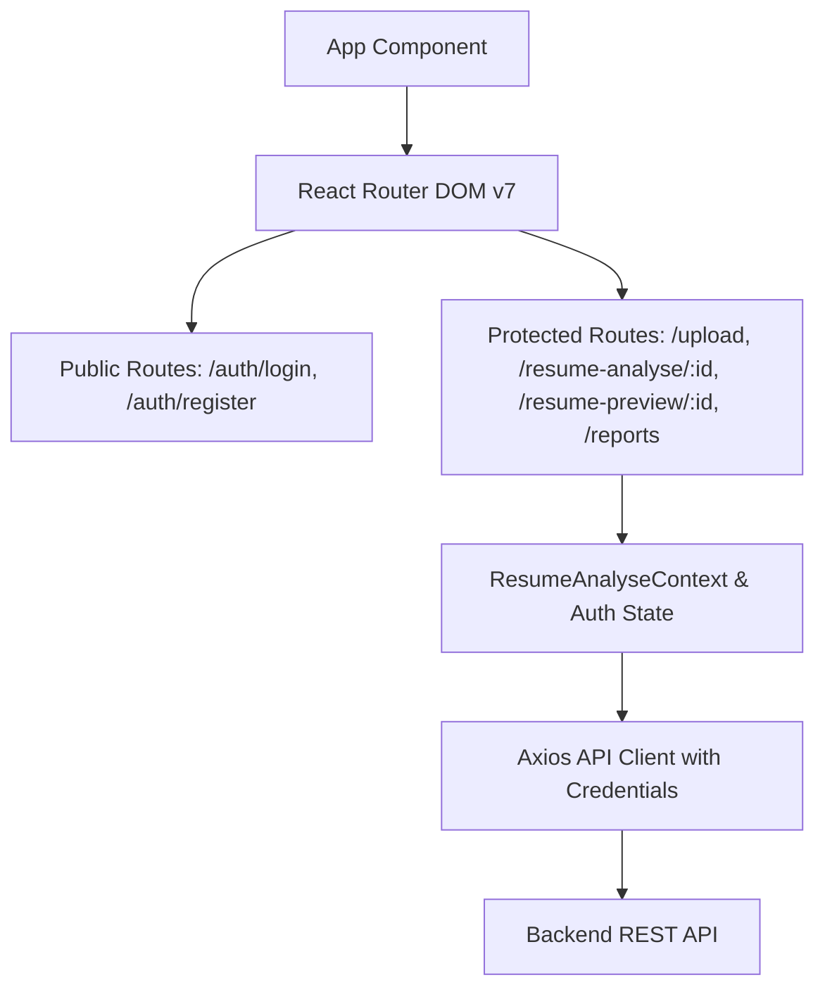

# AI Resume Analyzer — Frontend Client

[](https://react.dev/)
[](https://vite.dev/)
[](https://reactrouter.com/)
[](https://sass-lang.com/)
[](https://axios-http.com/)

A modern, responsive Single Page Application (SPA) built with React 19, Vite, and Sass for analyzing resumes against job descriptions, reviewing ATS breakdown reports, and downloading newly synthesized resumes.

---

## Architecture & Features



### Feature Modules
- **Authentication (`/features/auth`)**: Login and registration flows, session persistence, and `Protected` wrapper guarding authenticated views.
- **Resume Analysis (`/features/resumeAnalyse`)**:
  - `Upload`: Multi-input interface supporting PDF drag-and-drop, target job description textarea, and supplementary candidate summary.
  - `Analyse`: Interactive dashboard presenting ATS match score, missing vs matched skills, credential gap breakdowns, and project suggestions.
  - `Preview`: Formatted visual display of the candidate resume.
  - `Reports`: Historical dashboard listing all previous resume audits with direct navigation and re-download capabilities.

---

## Directory Structure

```text
Frontend/
├── public/                 # Static assets
├── src/
│   ├── features/
│   │   ├── auth/
│   │   │   ├── components/ # Protected route guard
│   │   │   ├── pages/      # Login.jsx, Register.jsx
│   │   │   └── services/   # Auth API calls
│   │   └── resumeAnalyse/
│   │       ├── hooks/      # Custom hooks
│   │       ├── pages/      # Upload, Analyse, Preview, Reports
│   │       ├── services/   # Resume API calls & PDF download handlers
│   │       ├── style/      # Feature-specific SCSS modules
│   │       └── resume-analyse-context.jsx # Resume global state provider
│   ├── routes.jsx          # Route definitions & navigation tree
│   ├── style.scss          # Global styling tokens & layouts
│   ├── main.jsx            # Application bootstrap
│   └── App.jsx             # Root React component
├── .env.development        # Local API URL configuration
├── .env.production         # Production deployment API endpoint
├── package.json            # Scripts and dependencies
└── vite.config.js          # Vite build config
```

---

## Getting Started

### Prerequisites
- Node.js `20.x` or higher
- Running backend service (see [Backend README](../Backend/README.md))

### 1. Installation
```bash
npm install
```

### 2. Environment Configuration
Create or update the environment files:

- **`.env.development`** (local backend):
  ```env
  VITE_API_URL=http://localhost:3000/api
  ```
- **`.env.production`** (production backend):
  ```env
  VITE_API_URL=https://your-production-backend.com/api
  ```

### 3. Run Development Server
```bash
npm run dev
```
Access the application at `http://localhost:5173`.

### 4. Build for Production
```bash
npm run build
```
The optimized production bundle will be generated in the `dist/` directory. You can preview the production build locally using:
```bash
npm run preview
```

---

## License

This project is licensed under the [ISC License](../LICENSE).
