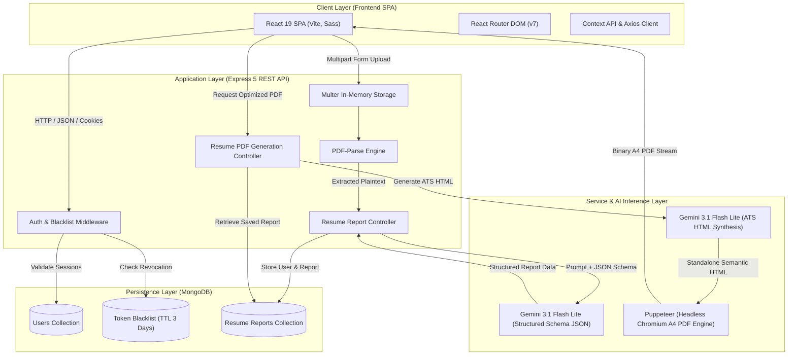
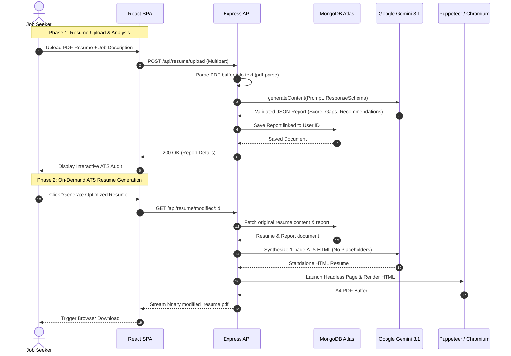

# AI Resume Analyzer & ATS Optimizer

[](https://react.dev/)
[](https://nodejs.org/)
[](https://expressjs.com/)
[](https://www.mongodb.com/)
[](https://ai.google.dev/)
[](https://pptr.dev/)
[](LICENSE)

An intelligent, full-stack career platform that leverages Google's Gemini AI to parse and evaluate resumes against target job descriptions, identify critical qualification gaps, and synthesize tailored, single-page, ATS-compliant PDF resumes on demand.

---

## Table of Contents

- [Overview](#overview)
- [System Architecture](#system-architecture)
- [Detailed Workflow](#detailed-workflow)
- [Key Features](#key-features)
- [Technology Stack](#technology-stack)
- [Key Design Decisions](#key-design-decisions)
- [Project Directory Structure](#project-directory-structure)
- [Setup & Run Instructions](#setup--run-instructions)
  - [Prerequisites](#prerequisites)
  - [Environment Variables](#environment-variables)
  - [Local Development Setup](#local-development-setup)
  - [Docker Setup](#docker-setup)
- [API Reference](#api-reference)
- [Contributing & License](#contributing--license)

---

## Overview

In today's recruitment landscape, Applicant Tracking Systems (ATS) automatically screen candidates based on keyword relevance, parseable formatting, and qualification alignment. Job seekers often struggle to identify why their resumes are rejected or how to tailor their experience for specific roles.

**AI Resume Analyzer & ATS Optimizer** solves this challenge through an automated two-stage pipeline:
1. **Comprehensive Diagnostic Analysis**: Evaluates resume text and candidate notes against target job requirements, generating structured scores, skill gap analyses, and actionable improvement recommendations.
2. **Deterministic ATS-Optimized Regeneration**: Transforms analysis feedback into a strict single-page, ATS-friendly HTML layout and rasterizes it into a print-ready A4 PDF via headless Chromium.

---

## System Architecture

The following diagram illustrates the high-level system architecture and data flows across the presentation, application, AI inference, and database layers:



---

## Detailed Workflow

The platform separates deep analytical parsing from heavy document rendering to ensure low latency and high availability:



---

## Key Features

- **In-Memory Resume Parsing**: Extracts structured text directly from uploaded PDFs without persisting temporary files to disk.
- **AI Match Scoring (0–100)**: Quantitative compatibility rating derived by analyzing overlap between candidate background and job requirements.
- **Skill Gap & Qualification Breakdown**: Itemizes matched skills, missing essential technologies, and missing credentials/certifications.
- **Project Recommendations**: Suggests domain-specific projects candidate can build or highlight to close competency gaps.
- **Strict 1-Page ATS PDF Generation**: Produces clean, machine-parseable single-page resumes formatted for ATS scanners using headless Chromium.
- **Stateless Authentication with Revocation**: Secure JWT-based sessions backed by MongoDB TTL token blacklisting for safe logout.
- **Client Disconnect Awareness**: Listens to socket cancellation events (`req.on('close')`) to prevent wasted AI compute and Puppeteer execution when users navigate away.

---

## Technology Stack

| Category | Technology | Version | Purpose |
| :--- | :--- | :--- | :--- |
| **Frontend Framework** | [React](https://react.dev/) | `^19.2.0` | Component-based reactive UI rendering |
| **Frontend Tooling** | [Vite](https://vite.dev/) | `^7.3.1` | Instant local server HMR and production bundling |
| **Client Routing** | [React Router DOM](https://reactrouter.com/) | `^7.13.1` | Declarative client-side routing & route guarding |
| **Client Styling** | [Sass (SCSS)](https://sass-lang.com/) | `^1.97.3` | Modular SCSS design system and responsive components |
| **HTTP Client** | [Axios](https://axios-http.com/) | `^1.14.0` | Promise-based API requests with credentials support |
| **Backend Runtime** | [Node.js](https://nodejs.org/) | `>=20.x` | Event-driven JavaScript server environment |
| **Web Framework** | [Express](https://expressjs.com/) | `^5.2.1` | REST API routing, middleware, and request dispatching |
| **Database** | [MongoDB](https://www.mongodb.com/) / [Mongoose](https://mongoosejs.com/) | `^9.2.3` | Document-oriented persistence with schema validation |
| **AI SDK** | [@google/genai](https://www.npmjs.com/package/@google/genai) | `^1.44.0` | Official Google GenAI SDK for Gemini 3.1 Flash Lite |
| **PDF Extraction** | [pdf-parse](https://www.npmjs.com/package/pdf-parse) | `^2.4.5` | In-memory text extraction from raw PDF buffers |
| **File Upload Handling**| [Multer](https://www.npmjs.com/package/multer) | `^2.1.1` | Multipart/form-data handler with 3MB memory limits |
| **PDF Generation** | [Puppeteer](https://pptr.dev/) | `^25.1.0` | Headless Chromium rendering engine for pixel-perfect A4 PDFs |
| **Authentication** | [jsonwebtoken](https://github.com/auth0/node-jsonwebtoken) & [bcrypt](https://github.com/kelektiv/node.bcrypt.js) | `^9.0.3` / `^6.0.0` | Salted password hashing and signed JWT authentication |
| **Containerization** | [Docker](https://www.docker.com/) | `20-slim` | Portable, containerized runtime including system Chromium |

---

## Key Design Decisions

### 1. Enforced JSON Schemas with Gemini 3.1 Flash Lite
Instead of relying on free-form prompts and fragile regex parsers, the application uses `@google/genai` with strict `responseSchema` definitions. The model (`gemini-3.1-flash-lite`) is constrained to output exact JSON objects matching the schema. This guarantees zero JSON parsing failures, deterministic field structures, and direct compatibility with Mongoose models.

### 2. Headless Chromium (Puppeteer) vs Client-Side PDF Generators
Traditional client-side libraries (such as `jsPDF` or `html2pdf.js`) struggle with complex CSS layouts, font rendering differences across operating systems, and page breaks. By rendering the resume on a server-side headless Chromium instance with `@media print` rules and strict A4 dimensions (`margin: 20px`), we guarantee 100% consistent typography, selectable text for ATS bots, and exact 1-page constraints.

### 3. In-Memory Buffer Processing vs Disk Storage
Uploaded files are stored purely in memory using `multer.memoryStorage()` with a 3 MB limit, fed directly into `pdf-parse`, and immediately garbage collected. This eliminates disk I/O bottlenecks, avoids filesystem permissions complications across container deployments, and prevents sensitive user resumes from lingering on server storage.

### 4. Socket Disconnection Awareness (`req.on('close')`)
Both AI analysis and PDF rasterization require computational resources and API credits. If a user closes the browser tab or cancels the request, the Express request socket fires `close`. Handlers set an `isCancelled` flag and exit early, preventing unnecessary LLM tokens and Puppeteer execution.

### 5. Stateless JWT with Database-Backed Revocation via MongoDB TTL
Pure stateless JWTs cannot be revoked prior to expiration without database checks, while purely stateful sessions introduce database overhead on every single static request. This architecture balances both: JWTs are validated cryptographically, and upon logout, the token is recorded in a lightweight `tokenBlacklist` collection. A MongoDB TTL (Time-To-Live) index automatically cleans up blacklist entries after 3 days (`expireAfterSeconds: 259200`), keeping the collection small and index scans virtually instantaneous.

### 6. Decoupled Analysis and PDF Generation
Analyzing a resume and synthesizing a modified resume are maintained as separate endpoints (`POST /upload` and `GET /modified/:id`). This allows users to inspect their scores and gaps immediately, without waiting for the secondary HTML-to-PDF compilation step until they explicitly request an optimized export.

---

## Project Directory Structure

```text
Resume Analyzer/
├── .agents/
│   └── rules/
│       └── readme-guidelines.md       # Repository guidelines for documentation
├── Backend/
│   ├── src/
│   │   ├── config/
│   │   │   ├── mongoose-connection.js # MongoDB connection setup
│   │   │   └── multer-config.js       # In-memory file upload configuration
│   │   ├── controllers/
│   │   │   ├── auth controllers      # login, register, logout, getMe
│   │   │   └── resumeReportController # PDF parse and AI analysis controller
│   │   ├── middlewares/
│   │   │   └── isLoggedIn.js          # JWT & token blacklist verification
│   │   ├── models/
│   │   │   ├── user-model.js          # User schema
│   │   │   ├── token-blacklist-model  # Blacklisted tokens with TTL index
│   │   │   └── resume-model.js        # Detailed analysis & gap reports
│   │   ├── routes/
│   │   │   ├── authRoutes.js          # /api/auth routes
│   │   │   └── resumeRoutes.js        # /api/resume routes
│   │   ├── services/
│   │   │   └── ai.js                  # Gemini GenAI & Puppeteer PDF services
│   │   └── app.js                     # Express app setup & CORS config
│   ├── Dockerfile                     # Multi-stage production container
│   ├── package.json                   # Backend dependencies and scripts
│   └── server.js                      # Application entrypoint
├── Frontend/
│   ├── src/
│   │   ├── features/
│   │   │   ├── auth/                  # Authentication pages and protected routes
│   │   │   └── resumeAnalyse/         # Upload, Analysis, Preview, & Reports
│   │   ├── routes.jsx                 # Client router configuration
│   │   ├── style.scss                 # Global styling rules
│   │   ├── main.jsx                   # React DOM entrypoint
│   │   └── App.jsx                    # Root application component
│   ├── .env.development               # Local development environment vars
│   ├── .env.production                # Production API endpoint configuration
│   ├── package.json                   # Frontend dependencies and scripts
│   └── vite.config.js                 # Vite bundler configuration
└── README.md                          # Master documentation
```

---

## Setup & Run Instructions

### Prerequisites

Ensure you have the following installed on your machine:
- **Node.js**: `v20.x` or higher recommended (minimum `v18.x`)
- **npm**: `v9.x` or higher
- **MongoDB**: A running MongoDB instance (local or [MongoDB Atlas](https://www.mongodb.com/atlas))
- **Google Gemini API Key**: Obtain a key from [Google AI Studio](https://aistudio.google.com/)

---

### Environment Variables

#### Backend (`Backend/.env`)
Create a `.env` file inside the `Backend/` directory:

| Variable | Description | Example / Default |
| :--- | :--- | :--- |
| `PORT` | Port number the Express API server listens on | `3000` or `5000` |
| `MONGODB_URI` | MongoDB connection string URI | `mongodb://localhost:27017/resume-analyzer` |
| `GEMINI_API_KEY` | Google Gemini API Key | `AIzaSy...` |
| `JWT_SECRET` | Secret key used for signing and verifying JSON Web Tokens | `your_secure_jwt_secret_key` |

#### Frontend (`Frontend/.env.development` & `Frontend/.env.production`)
Create or review environment files inside the `Frontend/` directory:

| File | Variable | Value |
| :--- | :--- | :--- |
| `.env.development` | `VITE_API_URL` | `http://localhost:3000/api` |
| `.env.production` | `VITE_API_URL` | `https://your-production-backend.com/api` |

---

### Local Development Setup

#### 1. Clone the Repository
```bash
git clone https://github.com/aasif-10/Resume-Project.git
cd "Resume-Project"
```

#### 2. Configure and Run Backend
```bash
cd Backend

# Install dependencies
npm install

# Create .env file with your credentials
# (Refer to Backend Environment Variables table above)

# Start backend in development mode (with nodemon)
npm run dev

# Or start in standard production mode:
# npm start
```
*The backend API will be available at `http://localhost:3000`.*

#### 3. Configure and Run Frontend
In a separate terminal:
```bash
cd Frontend

# Install dependencies
npm install

# Start Vite development server
npm run dev
```
*The frontend application will be available at `http://localhost:5173`.*

---

### Docker Setup

The project includes a production-ready `Dockerfile` in the `Backend` directory that preconfigures Chromium and all necessary Linux dependencies for headless PDF generation without missing library errors:

```bash
cd Backend

# Build Docker image
docker build -t resume-analyzer-backend .

# Run Docker container
docker run -p 3000:3000 \
  -e PORT=3000 \
  -e MONGODB_URI="your_mongodb_connection_string" \
  -e GEMINI_API_KEY="your_gemini_api_key" \
  -e JWT_SECRET="your_jwt_secret" \
  resume-analyzer-backend
```

---

## API Reference

### Authentication Endpoints (`/api/auth`)

| Method | Endpoint | Access | Description |
| :--- | :--- | :--- | :--- |
| `POST` | `/api/auth/register` | Public | Register a new user (`email`, `password`, `name`) |
| `POST` | `/api/auth/login` | Public | Authenticate user credentials and return HTTP-only JWT cookie |
| `GET` | `/api/auth/logout` | Public | Invalidate current JWT and add token to blacklist collection |
| `GET` | `/api/auth/get-me` | Private | Retrieve profile information for the authenticated user |

### Resume Operations Endpoints (`/api/resume`)

| Method | Endpoint | Access | Content-Type | Description |
| :--- | :--- | :--- | :--- | :--- |
| `POST` | `/api/resume/upload` | Private | `multipart/form-data` | Upload PDF resume, job description, and optional self-description to generate analysis report |
| `GET` | `/api/resume/all` | Private | `application/json` | Fetch all historical resume analysis reports for the authenticated user |
| `GET` | `/api/resume/:id` | Private | `application/json` | Fetch a single detailed resume report by its MongoDB ID |
| `GET` | `/api/resume/modified/:id` | Private | `application/pdf` | Generate and download an ATS-optimized, 1-page PDF resume |

---

## Contributing & License

Contributions, bug reports, and feature requests are welcome! Feel free to check the [issues page](https://github.com/aasif-10/Resume-Project/issues).

Distributed under the **ISC License**. See [LICENSE](LICENSE) for more information.
